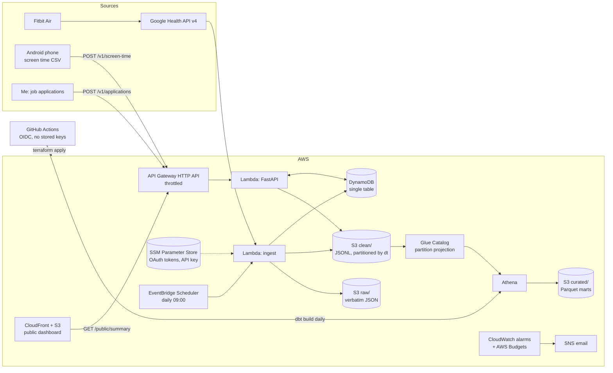

# Life API

**A personal data platform on AWS that tracks my sleep, fitness, screen time and job search, with a public dashboard that shows only totals and averages.**

My Fitbit feeds the Google Health API, my Android phone uploads screen time, and I log job applications through a REST API. A daily serverless pipeline lands everything in an S3 data lake, dbt models it in Athena, and a FastAPI service on Lambda serves it.

> Live dashboard: `https://<cloudfront-id>.cloudfront.net` · API docs: `<api-url>/docs`

---

## Architecture



| Layer | Choice | Why |
|---|---|---|
| API | FastAPI on Lambda (Mangum) behind API Gateway HTTP API | Typed, self-documenting (OpenAPI at `/docs`), and no cost when idle |
| Operational store | DynamoDB single table, on-demand | Millisecond reads for the API; no idle cost |
| Data lake | S3 `raw/` → `clean/` → `curated/` | Raw stays verbatim so any day can be replayed after a parser fix |
| Catalog / query | Glue tables with **partition projection** + Athena | No crawlers, no `MSCK REPAIR`; queries are capped at 1 GB scanned |
| Modeling | dbt (dbt-athena), Parquet marts, tests | Staging → marts, data tests, lineage docs; same models would run on Snowflake/Redshift |
| Infra | Terraform | Every resource in code, reproducible |
| CI/CD | GitHub Actions + AWS OIDC | Lint, test, validate on each PR; deploy from `main`; no long-lived keys |
| Ops | CloudWatch alarms, a dashboard, JSON logs, AWS Budgets | Alerts when ingest fails *or stops running*, and when spend crosses $2.50 |

## What it answers

```http
GET /public/summary                 # anyone: totals and averages only
GET /v1/days?start=2026-11-01       # me: merged daily metrics
GET /v1/insights/scroll-vs-sleep    # me: "do I sleep less after heavy-scroll days?"
POST /v1/applications               # me: log an application
PATCH /v1/applications/{id}         # me: applied → interviewing → offer
POST /v1/screen-time                # phone: per-app minutes for a day
```

dbt marts:
- **`fct_daily_life`**: one row per calendar day (sleep, stages, steps, resting HR, screen time, doomscrolling, applications sent, and the *next* night's sleep). Days without data still appear, so gaps in tracking are visible.
- **`fct_application_funnel`**: weekly applications, responses, interviews and response rate.

## Engineering decisions

- **Idempotent pipeline.** Each day writes to a fixed S3 key and an upsert in DynamoDB, so retries and backfills (`{"backfill_days": 14}`) never duplicate data. dbt keeps the latest `_ingested_at` per day.
- **Defensive parsing.** The Google Health API returns numbers as strings, and some response shapes are undocumented. Parsers search for values instead of assuming a path, and raw payloads are always kept.
- **Sleep belongs to the wake-up date.** Monday night's sleep counts toward Tuesday, which is how people actually think about "last night".
- **Privacy by design.** The public endpoint returns aggregates only; a test asserts that company names never appear in it. Write and private endpoints need an API key (constant-time compare, fails closed if not configured).
- **Least privilege IAM.** The API Lambda can only write `clean/screen_time/*`; the ingest Lambda can only write `raw/*` and its own datasets and update its own token. dbt gets a separate read-mostly role.
- **Cost guardrails.** Everything is pay-per-use; API Gateway is throttled; Athena queries are capped; a budget alarm emails me. Expected cost is under $1/month.
- **Retries.** The Google client backs off exponentially on 429/5xx, refreshes once on 401, and saves rotated refresh tokens.

## Repo layout

```
src/life_api/
  api/            FastAPI app, routers, auth dependency
  ingest/         Google Health client, transforms, screen time, daily job
  services/       pure summary + insight logic
  storage/        DynamoDB repository, S3 lake writer
  handlers.py     Lambda entry points
dbt/life/         sources, staging, marts, tests, seed (app categories)
infra/terraform/  all AWS resources
web/              public dashboard (static, served by CloudFront)
scripts/          OAuth consent, screen-time import, Lambda build
tests/            pytest + moto (no AWS account needed)
```

## Run it

```bash
pip install -e ".[dev]"
pytest                       # 32 tests, ~92% coverage, AWS mocked with moto
ruff check . && ruff format --check .
```

Deploying needs an AWS account and a Google Cloud OAuth client: see [docs/setup.md](docs/setup.md).

## Roadmap

- [ ] **Generative art**: a daily image made from the day's data (sleep stages as color bands, steps as density, scrolling as noise), written to S3 and shown on the dashboard
- [ ] **Weekly doomscroll report**: a scheduled Lambda that emails a summary via SES
- [ ] Small Android app that reads `UsageStatsManager` and posts screen time automatically
- [ ] Jobright CSV import
- [ ] Local development against an AWS emulator (floci / LocalStack)
